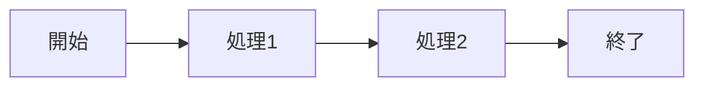

# tarikicode-svelte ブログ記事仕様

このドキュメントは、tarikicode-svelteリポジトリのブログ記事形式を定義します。

## Frontmatter仕様

すべてのブログ記事は、YAML frontmatter形式で以下のメタデータを含む必要があります：

```yaml
---
title: '記事のタイトル'
date: 'YYYY-MM-DD'
category: 'カテゴリ名'
tags: ['タグ1', 'タグ2', 'タグ3']
description: '記事の説明文（OGP/Twitter Cardに使用）'
image: 'https://example.com/image.png'
featured: false
type: 'blog'
---
```

### 必須フィールド

| フィールド    | 型     | 説明                                     | 例                                        |
| ------------- | ------ | ---------------------------------------- | ----------------------------------------- |
| `title`       | String | 記事のタイトル                           | `'OpenAIの世界展開戦略'`                  |
| `date`        | String | 公開日（YYYY-MM-DD形式）                 | `'2025-01-25'`                            |
| `category`    | String | カテゴリ                                 | `'AI'`, `'Development'`, `'Tech'`         |
| `tags`        | Array  | タグのリスト（3-5個推奨）                | `['OpenAI', 'ChatGPT', 'グローバル展開']` |
| `description` | String | 記事の要約（100-160文字推奨、OGP/SEO用） | `'OpenAIが新興国向け低価格プラン...'`     |
| `type`        | String | 記事タイプ                               | `'blog'` または `'work'`                  |

### オプションフィールド

| フィールド | 型      | 説明                                                        | デフォルト |
| ---------- | ------- | ----------------------------------------------------------- | ---------- |
| `image`    | String  | OGP画像URL（指定しない場合はAppConfig.post_stringから取得） | -          |
| `featured` | Boolean | トップページに表示するか                                    | `false`    |

## カテゴリーとタグのガイドライン

### 推奨カテゴリー

- **AI**: AI/機械学習全般、LLM、生成AI関連
- **Development**: 開発技術、プログラミング、フレームワーク
- **Tech**: 技術トレンド、ツール紹介
- **Tutorial**: チュートリアル、ハウツー記事
- **Opinion**: 考察、意見記事

### タグの選び方

- **具体的な技術名**: `'OpenAI'`, `'Claude'`, `'SvelteKit'`
- **トピック**: `'グローバル展開'`, `'価格戦略'`, `'API'`
- **対象読者**: `'初心者向け'`, `'上級者向け'`
- **記事の種類**: `'チュートリアル'`, `'ニュース解説'`

**推奨タグ数**: 3-5個（多すぎず少なすぎず）

## 記事構成のベストプラクティス

### 1. 導入部（リード）

記事の最初に、**太字**や**見出し3-4（###, ####）**を使って要点を簡潔に提示：

```markdown
### OpenAIの新戦略：新興国市場への本格進出

OpenAIが2025年10月、低価格サブスクリプションプラン「**ChatGPT Go**」を大幅に拡大し、**合計89カ国**で提供を開始しました。
```

### 2. 階層的な見出し構造

```markdown
### メインセクション（h3）

#### サブセクション（h4）

##### 詳細項目（h5）
```

- **h3（###）**: メインセクション（記事の大きな章）
- **h4（####）**: サブセクション（章内の大きなトピック）
- **h5（#####）**: 詳細項目（細かい説明）

### 3. 箇条書きと強調

重要なポイントは箇条書きと太字で読みやすく：

```markdown
ChatGPT Goは低価格ながら、無料プランを大きく上回る機能を提供します：

- **メッセージ上限**: 無料プランより高い日次上限
- **画像生成**: より多くの画像生成が可能
- **ファイルアップロード**: 1日あたりのアップロード数が増加
- **メモリ容量**: 無料プランの**2倍**のメモリ
```

### 4. データと事実の提示

具体的な数値やデータを含めて信頼性を高める：

```markdown
- **インド**: ₹399（約550円）
- **インドネシア**: Rp 75,000（約540円）
- **ナイジェリア**: ₦7,000（約560円）
```

### 5. まとめセクション

記事の最後に、要点をまとめたセクションを追加（オプション）：

```markdown
### まとめ

この記事では、OpenAIのChatGPT Go展開戦略について解説しました。主なポイントは以下の通りです：

1. 月額約500円という低価格設定
2. 89カ国への大規模展開
3. 新興国市場へのフォーカス
```

## 記事ファイル名の規則

ファイル名は以下の形式で作成：

```text
YYYY-MM-DD-slug.md
```

例：

- `2025-01-25-openai-chatgpt-go-expansion.md`
- `2025-01-26-claude-sonnet-4-release.md`

## 特殊機能

### Mermaid図

フローチャート、シーケンス図などをサポート：

````markdown

````

### OGPカード記法

外部URLのプレビューカードを表示：

```markdown
[[ogp:https://example.com/article]]
```

### コードブロック

シンタックスハイライト対応：

````markdown
```typescript
interface User {
	name: string;
	age: number;
}
```
````

## 実際の記事例

以下は、実際のブログ記事の構造例です：

```markdown
---
title: 'OpenAIの世界展開戦略：ChatGPT Goプランで89カ国に拡大'
date: '2025-11-08'
category: 'AI'
tags: ['OpenAI', 'ChatGPT', 'グローバル展開', '価格戦略']
description: 'OpenAIが新興国向け低価格プラン「ChatGPT Go」を89カ国に展開。月額約500円で利用可能な戦略の裏側と、日本市場への示唆を解説します。'
image: 'https://example.com/image.png'
featured: true
type: 'blog'
---

### OpenAIの新戦略：新興国市場への本格進出

OpenAIが2025年10月、低価格サブスクリプションプラン「**ChatGPT Go**」を大幅に拡大し、**合計89カ国**で提供を開始しました。月額約5ドル（約500円）という価格設定で、アジアとアフリカの新興国市場を積極的に開拓しています。

#### ChatGPT Goとは？

##### 価格設定：現地通貨で月額約500円

ChatGPT Goは、新興国市場向けに設計された低価格プランです。各国の経済状況に合わせた価格設定が特徴です：

- **インド**: ₹399（約550円）
- **インドネシア**: Rp 75,000（約540円）
- **ナイジェリア**: ₦7,000（約560円）

##### 提供される機能

ChatGPT Goは低価格ながら、無料プランを大きく上回る機能を提供します：

- **メッセージ上限**: 無料プランより高い日次上限
- **画像生成**: より多くの画像生成が可能
- **ファイルアップロード**: 1日あたりのアップロード数が増加
- **メモリ容量**: 無料プランの**2倍**のメモリ

### まとめ

OpenAIのChatGPT Go展開は、新興国市場への本格的な参入を示しています。低価格設定と現地通貨対応により、グローバルなユーザーベース拡大を目指す戦略です。
```

## AI記事生成時の注意点

AIニュース記事を生成する際は、以下の点に注意してください：

1. **日付の正確性**: 記事の `date` フィールドは、記事作成日を正確に反映すること
2. **タイトルの魅力**: 読者の興味を引く、具体的で魅力的なタイトルを作成
3. **description の最適化**: OGP/Twitter Cardで表示されるため、100-160文字で記事の要点を簡潔に
4. **タグの適切性**: LLM/生成AI関連の具体的なタグを3-5個選択
5. **構造化**: 見出しを階層的に使用し、読みやすい構造を維持
6. **データの信頼性**: ニュースソースから得た情報は、正確に引用・要約する
7. **日本語の品質**: 自然で読みやすい日本語を心がける

## ファイル保存場所

生成した記事は、以下のいずれかの場所に保存：

- `src/posts/YYYY-MM-DD-slug.md`（推奨）
- `src/posts/blog/YYYY-MM-DD-slug.md`
- `src/posts/works/YYYY-MM-DD-slug.md`（作品紹介記事の場合）
