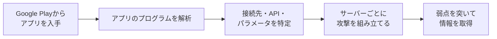

### A2B攻撃とは──スマホアプリを解析して裏側のサーバーを狙う、相次ぐ情報漏えいの一因

2026年10月13日、情報通信研究機構（NICT）の脅威情報分析チーム「LETTICE」が、「A2B攻撃」という攻撃手法への注意喚起を出した。同じ日に総務省も、事業者に向けて対策の徹底を呼びかけている。

A2Bは「App-to-Backend」の略だ。すごく雑に言うと、「誰でもダウンロードできるスマホアプリを分解して、その裏でつながっているサーバーの攻め方を調べる」手口である。NICTは、国内で相次いでいる個人情報の漏えい事案の原因の一つとして、この攻撃を確認したとしている。

名前は新しいが、仕組み自体は難しくない。この記事では、専門知識がなくても分かるように、アプリとサーバーの関係から順に説明していく。

#### サマリー

| 項目               | 内容                                                                    |
| ------------------ | ----------------------------------------------------------------------- |
| 名称               | A2B攻撃（App-to-Backend Attack）                                        |
| 公表               | 2026年10月13日、NICTの脅威情報分析チームLETTICE。同日に総務省も注意喚起 |
| 手口               | 公開されたAndroidアプリを解析し、接続先のサーバーに合わせた攻撃を行う   |
| 主に狙われる弱点   | SSRF、RCE、SQLインジェクション、IDOR（認可の不備）の4種類               |
| 影響が及びうる範囲 | Androidアプリが中心。同様の問題はiOSアプリやWebサービスでも起こりうる   |
| 事業者への推奨     | 侵害の確認、脆弱性の点検、暫定的な緩和策の3つ                           |

### そもそも「アプリの裏側」とは何か

A2B攻撃を理解するには、まずスマホアプリの仕組みを押さえておく必要がある。

ショッピングアプリで注文履歴を開くとき、履歴のデータはスマホの中にあるわけではない。アプリはインターネットの向こうにある「バックエンドサーバー」（ログインの確認や会員情報の管理をする、裏側のコンピューター）に問い合わせて、データを受け取っている。

このアプリとサーバーのやり取りの窓口を「API」（アプリとサーバーが情報をやり取りするための決まりごと）と呼ぶ。

レストランにたとえると分かりやすい。

| レストラン   | アプリの世界         | 役割                               |
| ------------ | -------------------- | ---------------------------------- |
| 客席の注文票 | スマホアプリ         | 利用者が操作する画面               |
| 厨房への伝票 | API                  | 決まった書式で注文を厨房に伝える   |
| 厨房と倉庫   | バックエンドサーバー | 注文を処理し、食材（データ）を出す |

ふだん私たちは、注文票（アプリ）の画面に沿ってしか注文できない。でも厨房（サーバー）から見れば、届くのは「伝票」だけだ。正しい書式の伝票さえ書ければ、注文票を通さなくても厨房に直接注文を送れてしまう。

### A2B攻撃の流れ

NICTの注意喚起によると、確認された攻撃は次の流れで進む。

攻撃者はまず、Google Playの日本地域で公開されているAndroidアプリを入手する。次にそのプログラムを解析し、アプリがどのサーバーに、どんな書式で、どんな項目を送っているかを調べる。レストランのたとえで言えば、「厨房への伝票の書き方」を突き止める段階だ。

そのうえで、調べた情報をもとに、サーバーの弱点を探す問い合わせを直接送り込む。アプリの画面からはできない操作も、伝票の書き方さえ分かれば試せてしまう。

NICTが挙げる特徴は2つある。

- 不特定多数のサーバーに同じ攻撃をばらまくのではなく、アプリの解析結果をもとに、サーバーごとに攻撃の中身を変えている
- ログインしなくても使えるAPIだけでなく、ログイン後に使えるAPIも攻撃対象になる場合がある

ここで一番大事なのは、**アプリ自体に欠陥がなくても、サーバー側の確認が甘ければ情報は漏れる**という点だ。アプリをどれだけ丁寧に作っても、攻撃者はアプリを通らずにサーバーへ直接話しかけてくる。

### 狙われる4つの弱点

NICTによると、今回の攻撃で主に狙われているのは次の4種類の脆弱性（ソフトウェアの弱点）だ。

| 名称                                   | ざっくり言うと                                         | レストランでたとえると                                       |
| -------------------------------------- | ------------------------------------------------------ | ------------------------------------------------------------ |
| IDOR（BOLAとも呼ぶ）                   | 番号を書き換えるだけで、他人のデータが見えてしまう     | 伝票の席番号を変えたら、別のテーブルの注文内容が見えた       |
| SQLインジェクション                    | 入力欄に命令文を紛れ込ませ、データベースを操作する     | 伝票の備考欄に「倉庫の在庫表を全部持ってきて」と書く         |
| SSRF（サーバーサイド・リクエスト偽造） | サーバーに、外からは届かない内部の場所へ通信させる     | 厨房のスタッフに頼んで、関係者以外立入禁止の部屋を開けさせる |
| RCE（リモートコード実行）              | 外から送った命令を、サーバー上でプログラムとして動かす | 伝票に書いた指示で、厨房の機械そのものを操作できてしまう     |

非専門家が一番イメージしやすく、被害も大きくなりやすいのがIDORだ。たとえば「自分の会員情報を表示する」APIで、問い合わせに含まれる会員番号を1つずらすと、別の人の氏名やメールアドレスが返ってくる。サーバーが「この人に、この番号の情報を見せてよいか」を確認していないために起きる。

NICTは、番号が連番などで推測しやすい場合、大量の情報漏えいにつながるおそれがあると指摘している。番号を1から順に試すだけで、会員全員分を集められてしまうからだ。

### なぜ今、注意喚起が出たのか

背景には、2026年秋の情報漏えいの多発がある。JPCERT/CC（日本のセキュリティ事故の情報を集めて調整する組織）は10月8日の注意喚起で、「直近2026年9月前後で国内組織における不正アクセスによる個人情報等の漏えい被害が相次いでいる」と書いている。

JPCERT/CCは同じ注意喚起の中で、確認されている手口の一つとして、一般公開しているスマートフォンアプリを解析し、APIの接続先やキーを特定する攻撃を挙げていた。NICTの注意喚起も、このJPCERT/CCの注意喚起を参考文献に挙げている。

もう一つの背景がAIだ。NICTは、AIの活用によってプログラムの解析や脆弱性の探索が効率化されていることに触れ、こうした攻撃がより多くのシステムに及ぶ可能性に注意が必要だとしている。これまで手間のかかったアプリの解析が楽になれば、狙われるアプリの数も増えうる、という懸念である。

ただし、NICTの注意喚起は、**今回確認した攻撃でAIが使われたとまでは書いていない**。「AIが攻撃した」のではなく、「AIで攻撃の下準備が楽になる時代に、この手口が広がるおそれがある」と読むのが正確だ。

### 事業者に求められている対策

NICTは、Androidアプリを公開している事業者に、次の3つを早急に行うよう推奨している。

| 対策           | 主な内容                                                                                    |
| -------------- | ------------------------------------------------------------------------------------------- |
| 侵害の確認     | 公開しているAPIやサーバーを洗い出し、2026年8月以降のアクセスログに不審な操作がないか調べる  |
| 脆弱性の点検   | 認可の不備（IDOR）、認証の不備、SQLインジェクション、SSRF、クラウドの設定不備などを点検する |
| 暫定的な緩和策 | 不要なAPIや検証環境を止める、アクセス元や頻度を制限する、漏れた疑いのある鍵を作り直す       |

洗い出しの対象には、今のアプリが使っているAPIだけでなく、古いバージョンのAPI、サブドメイン、検証環境も含めるよう求めている。

根本的な対策として、NICTと総務省がそろって強調しているのが、「アプリは解析される前提で、サーバー側で確認する」という考え方だ。NICTは、公開アプリが解析されること自体を完全に防ぐのは難しいとしている。だからこそ、**アプリの中身や伝票の書き方が知られても大丈夫なように、サーバー側で「誰が」「何を」してよいかを毎回確かめる**ことが重要になる。

総務省は、同様の問題がAndroidアプリに限らず、iOSアプリやWebサービスでも起こりうるとしている。「うちはiPhoneアプリだけだから関係ない」とは言えない点に注意したい。

<!-- 実体験：行政DXに関わる立場から見た、自治体や公共サービスのアプリ・APIへの示唆や、現場で感じていること -->

### まとめ

A2B攻撃のポイントは次の4つだ。

- 公開されたAndroidアプリを解析し、裏側のサーバーへの攻撃に使う手口。NICTが国内の情報漏えいの原因の一つとして確認した
- アプリ自体に欠陥がなくても、サーバー側の認証・認可や入力の確認が甘ければ情報が漏れる
- 主な標的はIDOR、SQLインジェクション、SSRF、RCEの4種類。特にIDORは番号を変えるだけで他人の情報が見えてしまう
- 事業者は2026年8月以降のログ確認と、サーバー側の点検を急ぐよう求められている。iOSアプリやWebサービスも対象になりうる

アプリは、店の外に置かれた注文票のようなものだ。誰でも持ち帰って、書き方を調べられる。A2B攻撃は、その当たり前の事実を突いた攻撃だと言える。守る側にとって大事なのは、アプリを隠すことより、厨房に届いた伝票を一枚ずつ確かめることだ。

**情報ソース：**

[[ogp:https://www.nict.go.jp/press/2026/10/13-1.html]]

[[ogp:https://cynex.nict.go.jp/library/261013-01.html]]

[[ogp:https://www.soumu.go.jp/menu_kyotsuu/important/kinkyu02_000680.html]]

[[ogp:https://www.jpcert.or.jp/at/2026/at260030.html]]

[[ogp:https://www.itmedia.co.jp/news/article/2610/13/2000002230/]]

[[ogp:https://xtech.nikkei.com/atcl/nxt/column/18/03790/101400005/]]
