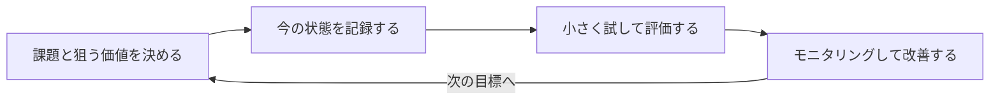

### AIの価値を「削減時間」だけで測っていないか──「システム時代の脳」から抜け出す3つの視点

AIを導入すると、まず問われるのは「何時間削減できたか」「費用対効果はどうか」だ。分かりやすく、説明もしやすい。

ただ、私は前からこの物差しに違和感があった。費用対効果や業務削減時間は、従来の「システムありき」の考え方で重視されてきた評価軸だ。AIが登場しても、その考え方をほとんど変えずに使っているように見える。

#### 「前より休めなくなった」という声

最近、avex代表取締役会長の松浦勝人氏が、noteに「AIに書かせたら、前より休めなくなった」という記事を書いていた。AIに記事を書かせると、初稿は驚くほど早く出てくる。ところが、事実の誤りを直し、言い回しを整えているうちに半日が消える。並行して何本も案件を走らせられるようになった分、AIを使うほど前より疲れている、という内容だ。

削減時間だけで測れば、こうした経験は「効率化できなかった」としか評価されない。一方で松浦氏は、自分が忘れていた昔の連載の一節をAIが拾い上げてくることや、昼に思いついた英語版が夕方には公開されていたことも書いている。AIがもたらす価値は、本当に時間の長さだけで表せるのだろうか。

#### Anthropic社内で起きていること

この問いをもう一歩進めて考えるきっかけになったのが、Anthropicが2026年10月に公開した社内レポートだ。技術部門の若手社員の構成比は2025年初めの21%から14%へ、若手の技術職採用の構成比は27%から9%へ下がった。一方、カレンダー上の会議時間は従業員1人当たりの中央値で前年比20%増え、技術系の個人貢献職でも16%増えていた。

レポートは、社内のさまざまなデータに17人へのインタビューを組み合わせ、AIが深く組み込まれた職場で仕事や人員構成がどう変わっているかを記録している。

ただし、この数字から「AIが若手採用を減らした」「AIが会議を増やした」と一般化することはできない。レポート自身、会議時間の伸びの一部は会社の成長や非技術職の比率変化によると説明している。因果関係を証明する実験ではなく、AI活用の最前線にいる企業の観察記録である。

それでも、考えたいことがある。**AIが作業を速めたとして、浮いた時間や新しくできるようになったことは、組織の力や顧客・住民への価値につながっているのだろうか**。

#### 削減時間だけでは、何がこぼれ落ちるのか

時間は大事な指標だ。作業時間やコストが下がれば、別の仕事に人を回せる。ただ、AIを使うと、指示を書く時間、出力を読む時間、事実を確かめる時間、直す時間も生まれる。最初の作業だけが短くなっても、確認や手戻りまで含めると、仕事全体の負担が増えていることもある。冒頭の松浦氏の「直しに半日かかる」は、まさにこの状態だ。

反対に、作業時間がほとんど変わらなくても価値が生まれることはある。以前は手が回らなかった調査ができた、複数の案を比べられた、専門家に相談する前に論点を整理できた。削減時間だけで見ると、こうした変化は「成果が出ていない」と判定されてしまう。

実際、AIの効果は仕事の内容や使う人によっても違ってくる。5,172人のカスタマーサポート担当者を対象とした2025年の研究では、AIアシスタントを使えるようになると、1時間当たりの解決件数が平均15%増えた。ただし効果は経験の浅い担当者に大きく、熟練者では処理速度がわずかに上がる一方、対応の質はわずかに下がっていた。

758人のコンサルタントが参加したHarvard Business SchoolとBCGの実験では、AIが得意な範囲の課題で、作業速度が25%以上、成果の質が40%以上上がった。一方で研究チームは、AIが得意な課題と不得意な課題の境界を「ギザギザした技術フロンティア」と呼び、見た目の難しさだけでは見分けにくいと指摘している。平均的な効率の数字だけでなく、どの仕事で質が上がり、どこで人の確認が必要だったかを見なければ、AIの価値は正しく測れない。

#### 私が見たい3つの価値

では、削減時間のほかに何を見ればよいのか。私は、少なくとも次の3つに目を向けたい。

##### ① 知識・知見の幅が広がる

これまで知らなかった情報に、たどり着きやすくなった。言語の壁や専門性の高さで読むのが難しかった論文なども、AIに要約や言い換えを頼めば、内容をつかみやすくなる。

ここで増えているのは、作業の速さではなく、自分が触れられる知識の範囲だ。

##### ② 専門性の障壁が下がる

専門家でなくても、一定の水準の情報を得て、作業を進められるようになった。技術や制度の用語を調べたり、複数の選択肢を比べたり、初歩的な疑問を整理したりすることは、専門外の人にもできるようになりつつある。

これまでなら、専門家に聞かなければ前に進めなかった場面で、自分である程度まで考えられる。

##### ③ 思考や発想が多角的になる

自分とは違う視点や反論をもらったり、一人では思いつかないアイデアに出会ったりしやすくなった。考えを深めるための「壁打ち相手」がいつでもいる状態だ。

アイデアの数や、検討した論点の幅は、時間では測れない。それでも、最終的な判断の質を左右するのは、こうした部分だと私は考えている。

#### それでも、専門家の代わりにはならない

ただ、専門知識を得やすくなったからといって、専門家と同じ役割まで担えるわけではない。

たとえば、AIで法律の知識を得ることはできても、弁護士として依頼を受け、法的な責任を負い、問題が起きたときに対応するところまでは引き受けられない。

システム開発も同じだ。AIでプログラムを作れるようになっても、品質保証やセキュリティ、保守運用、障害対応、契約上の責任まで、個人が担えるとは限らない。

専門家の価値は、知識や技術に加えて、責任、継続性、組織の力、社会的な信用が合わさって成り立っている。AIの回答が間違っていたとき、説明し、直し、結果を引き受ける責任も、AIを使ったからといってAIに移るわけではない。

だから、私がこの3つの視点で目指しているのは、誰もが専門性を身につけて、専門家や専門の会社に頼らなくて済むようにすることではない。**専門知識への壁を下げ、専門家とよりよく協働できる組織の力を高めること**だ。

#### 「個人ができること」と「組織ができること」は違う

もう一つ考えておきたいのは、AIで個人の能力が広がっても、それがそのまま組織の力になるとは限らないということだ。

たとえば、職員がAIを使って新しい知識を得たり、業務改善のアイデアを考えたりしても、その人だけができる状態では、異動や退職とともに失われてしまう。よいアイデアがあっても、それを試す仕組みや判断する場がなければ、実際の改善にはつながらない。

AIで得た知識や経験を共有し、業務の進め方や判断基準に取り入れ、ほかの職員も使えるようにする。そこまで進んで初めて、個人が得た恩恵が組織の力になっていくのだと思う。

だからこそ、AIで個人が何をできるようになったかに加えて、その変化が組織に何をもたらし、顧客や住民にどんな価値を届けられたのかまで見ていく必要がある。

#### 価値を前提に目標を立て、組織で評価する

では、こうした価値を組織でどう扱えばよいのか。大事なのは、AIを使った後で効果を探すのではなく、使う前に「どの価値を、誰のために実現したいのか」を決めておくことだ。

流れにすると、たとえば次のようになる。

1. 解決したい課題と、狙う価値（知識の拡張、障壁の低下、思考の多角化、そして時間の削減）を決める
2. 今の状態を記録し、比べる基準を置く
3. 小さく試し、時間だけでなく、質や手戻り、人の負担も合わせて評価する
4. 結果をモニタリングし、手順や教育、次の目標に反映して改善する

自治体のシステム調達で考えてみる。職員がAIを使って技術用語や構成案を学んだとしても、その成果は「職員だけでシステムを作れるか」では測らない。必要な要件を具体的に説明できたか、事業者の提案に根拠を求められたか、責任分担のあいまいさや運用のリスクに気づけたか、導入後の手戻りを減らせたかで測る。

目標も「職員のAI利用を月何回にする」ではなく、「調達前に必要な要件と運用上のリスクを明らかにし、事業者との認識のずれや導入後の手戻りを減らす」になる。知識が専門家を遠ざけるのではなく、専門家との対話を深くする。

「②専門性の障壁が下がる」という価値が、組織の成果として表れるのは、こういう場面だ。

数字にできるものだけを数える必要はない。案件の記録や成果物のレビュー、関わった専門家や担当者への聞き取りを組み合わせればよい。ただし、導入前後の比較だけで、変化のすべてをAIの効果と言い切ることはできない。担当者や業務量、制度も変わるからだ。何が変わり、ほかにどんな要因がありうるかも、合わせて記録しておきたい。

#### 見落としやすい副作用も、合わせて見る

価値を広く見るなら、マイナスの変化も同じように見ておく必要がある。

1つ目は、人の注意力が追いつかなくなることだ。Anthropicのレポートは、AIの出力が増えるほど、人間の注意力がボトルネックになっていると書いている。冒頭の松浦氏も、「判断する仕事だけが、こちらに残る。しかも量が増える」と書いていた。会議時間の増加も、AIの出力を確かめ、役割を調整し、判断するための話し合いなら、必要な投資かもしれない。見るべきは会議の長さそのものではなく、それに見合った判断や成果が生まれているかだ。

2つ目は、考える力が弱まるおそれだ。Microsoft Researchなどの2025年の研究は、319人の知識労働者への調査と936件の利用例を分析した。その結果、AIの回答への自信が高い人ほど、批判的に考える努力が少ないと自己申告する傾向があった。自己申告にもとづく調査で、AIが判断力を下げると証明したものではない。それでも、出力を確かめる習慣や、自分の頭で考える機会を残しておく理由にはなる。

3つ目は、若手が育つ機会だ。Anthropicの若手比率の変化だけで、AIが採用を減らしたとは言えない。ただ、目の前の処理量が増える一方で、次の世代が実務を通じて専門性を身につける道が細っていないかは、短期の効率指標では見えにくい。組織として、継続して問い続けるべきことだと思う。

#### まとめ

AIの価値をどう捉え、どんな目標を立て、どう評価し、改善とモニタリングを回していくか。私が探したいのは、その答えを持っている組織の姿だ。

それは、最新のモデルを入れた組織でも、利用回数が多い組織でもないと思う。**削減時間だけでなく、知識の広がりや判断の質といった価値に目を向け、それを前提に目標を立て、組織として評価し、改善し続けられる組織**こそ、今の時代に合った先進的なAIの使い方をしているのではないか。

自戒も込めて書くと、AIの効果を削減時間や手間の省き方だけで見る「システム時代の脳」から、私たちはそろそろ抜け出したほうがよい。

**情報ソース：**

[[ogp:https://www.anthropic.com/research/employment-at-anthropic]]

[[ogp:https://arxiv.org/abs/2304.11771]]

[[ogp:https://aiinstitute.hbs.edu/navigating-the-jagged-technological-frontier/]]

[[ogp:https://www.microsoft.com/en-us/research/publication/the-impact-of-generative-ai-on-critical-thinking-self-reported-reductions-in-cognitive-effort-and-confidence-effects-from-a-survey-of-knowledge-workers/]]

[[ogp:https://note.com/maxmatsuura/n/ne59969fd6e71]]

[[ogp:https://techcrunch.com/2026/10/17/anthropic-says-its-workforce-has-become-less-junior-and-is-spending-more-time-in-meetings/]]
