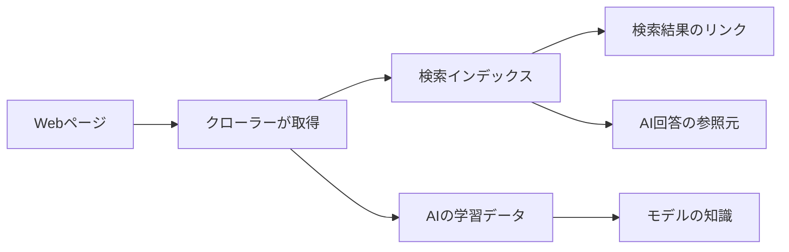

### AIの「学習だけ」を断る共通の合図──robots.txtの仕組みと、検索と学習の違い

「検索結果には載せてほしい。でも、AIの学習には使わないでほしい」。ブログやニュースサイトを運営していると、こう考える人は多いはずだ。ところがこれまでは、その意思をAI企業ごとに別々の書き方で伝える必要があった。

2026年10月30日、OpenAI、Google、Microsoft、Anthropicの4社が、robots.txtに共通の設定を1つ追加するだけで、複数のAI企業にまとめて「学習には使わないで」と伝えられる共通の合図に対応すると表明した。提案したのはAnthropicで標準化を担当するKevin Kelley氏で、インターネットの標準を決めるIETF（Internet Engineering Task Force）に、個人のInternet-Draft（標準化に向けた草案）として提出されている。

この記事では、ニュースの中身に加えて、そもそもrobots.txtとは何か、そしてAIが絡むと混同しやすい「検索」「学習」「回答時の参照」の違いを、順を追って整理する。

#### サマリー

| 項目           | 内容                                                                        |
| -------------- | --------------------------------------------------------------------------- |
| 発表日         | 2026年10月30日（各社がブログ等で発表）                                      |
| 合図の名前     | `__usage_ai-training`（robots.txtのUser-agent行に書く「ポリシートークン」） |
| 提案の位置づけ | 個人提出のInternet-Draft（第0版。IETFが承認した標準案ではない）             |
| 意味           | 生成AIモデルの学習に使ってよいか／使わないでほしいかの意思表示              |
| 対象外         | 検索への掲載、クロール（取得）そのもの                                      |
| 対応時期       | Anthropicは対応済み、Google・Microsoftは2027年、OpenAIは今後数か月          |

#### そもそもrobots.txtとは

robots.txtは、サイトの一番上（`https://example.com/robots.txt`）に置くテキストファイルだ。検索エンジンなどの自動巡回プログラム（クローラー）に、「このページは見に来ないで」と伝えるために使う。

すごく雑に言うと、**お店の入口に貼る「関係者以外立入禁止」の張り紙**である。1994年にMartijn Koster氏が考案し、長く慣習として使われてきたのち、2022年9月に「RFC 9309」として正式に標準化された。

##### 書き方の基本

書き方は単純で、「どのクローラーに（User-agent）」「どこを禁止／許可するか（Disallow／Allow）」を並べるだけだ。

```text
User-agent: Googlebot
Disallow: /private/

User-agent: *
Allow: /

Sitemap: https://example.com/sitemap.xml
```

1つ目のかたまり（グループ）は「Googlebotは `/private/` 以下に来ないで」、2つ目は「それ以外のクローラーは全部見てよい」という意味になる。`*` は「名前を指定していないクローラー全員」を表す。

ルールが重なったときは、パスが一番長く一致したルールが優先される。たとえば `Disallow: /blog/` と `Allow: /blog/public/` があれば、`/blog/public/` 以下は許可、それ以外の `/blog/` は禁止になる。

##### 守らせる仕組みではない

ここが一番誤解されやすいところだ。RFC 9309には「これらのルールはアクセス認可の仕組みではない」と明記されている。**robots.txtはお願いであって、鍵ではない**。行儀のよいクローラーは守るが、守らないクローラーを技術的に止める力はない。

むしろ、robots.txtに `Disallow: /secret-admin/` と書くと、そのパスの存在を世界に公開することになる。見られたくないページは、ログイン認証などで本当に鍵をかける必要がある。

ほかにも、運用で知っておくとよい決まりがいくつかある。

| 状況                                   | クローラーの扱い（RFC 9309）     |
| -------------------------------------- | -------------------------------- |
| 404など4xxで取得できない（※）          | 制限なしとみなしてよい           |
| サーバーエラー（500など5xx）で取れない | 全面禁止とみなさなければならない |
| キャッシュ                             | 原則24時間以内に読み直す         |
| ファイルサイズ                         | 少なくとも500KiBまでは解析される |

※RFC 9309は400番台をまとめて「取得不能（制限なし）」と定めているが、実際の扱いはクローラーによって異なる場合がある。たとえばGoogleは、429（Too Many Requests、アクセス過多）だけは例外とし、制限なしとはみなさない。

robots.txtを書き換えてもすぐには反映されないのは、このキャッシュのためだ。OpenAIも、検索への反映には約24時間かかるとしている。

<!-- 実体験：自分のサイトでrobots.txtを書き換えた経験や、Search Consoleで反映を確認した話があれば -->

#### 「検索」「学習」「回答時の参照」はどう違うか

AIが登場してから、同じ「クローラーがページを取りに来る」でも、取ったページの使われ方が大きく3つに分かれた。図書館にたとえると分かりやすい。

| 使われ方                         | 図書館でたとえると                         | ページはどうなるか                     | サイトへのリンク         |
| -------------------------------- | ------------------------------------------ | -------------------------------------- | ------------------------ |
| 検索（インデックス）             | 本の場所を書いた索引カードを作る           | 内容の要約と場所が索引に載る           | 検索結果に表示される     |
| 学習（トレーニング）             | 司書が本を読み込んで知識として覚える       | AIモデルの中身（パラメータ）に溶け込む | 基本的に残らない         |
| 回答時の参照（グラウンディング） | 質問されたときに、その場で本を開いて答える | 回答の材料としてその都度読まれる       | 引用元として示されやすい |

##### 検索：索引に載せる

従来の検索エンジンは、ページを取ってきて「どこに何が書いてあるか」の索引を作る。ユーザーが検索すると索引から候補を探し、リンクを並べる。ページの内容そのものは元のサイトにあり、読者はリンクをたどってサイトを訪れる。

##### 学習：モデルの中身に溶け込む

学習は根本的に違う。IETFの議論では、AI学習を「生成AIモデルの学習済みパラメータを変更するためにコンテンツを使うこと」と定義している。

すごく雑に言うと、**学習に使われたページは、本として棚に並ぶのではなく、司書の頭の中の知識になる**。どのページから覚えたかという対応は基本的に残らないため、回答に元のページへのリンクや引用が付くとは限らない。また、一度覚えたことを、あとから特定のページの分だけ忘れさせるのは一般に難しい。サイト運営者が学習に慎重になる理由の一つがここにある。

なお、この定義は「生成」AIに限っている。分類やランキング（並べ替え）だけに使うモデルの学習は含まないため、検索結果の順位付けだけに使うモデルの学習は、定義上この「学習」には当たらない。

##### 回答時の参照：その場で本を開く

3つ目が、AIが質問に答えるときにWebページを読みに行き、その内容を材料に回答を作る使い方だ。グラウンディング（Grounding）と呼ばれ、AIが事実と違うことを言う「ハルシネーション」を減らす目的で使われる。RAG（検索拡張生成）という言葉で聞いたことがある人もいるだろう。

なお、検索とグラウンディングは対立するものではない。検索で見つけたページを、AIが回答の根拠として読むことも多い。読みに行く先は検索インデックスとは限らず、ユーザーが示したURLを直接読む場合もある。この記事では、情報を「見つける」ことと、見つけた情報を回答の「根拠に使う」ことを分けて説明している。

Microsoftはこれを「コンテンツを、AIが生成する回答の判断材料として使うこと」と説明している。学習と違ってモデルの中身は変わらず、回答のたびに読まれる。そのため、引用元としてリンクを示しやすい。Googleのヘルプも、検索の「AIによる概要」ではサイトの内容がリンクとして表示され、AIの回答のグラウンディングにも使われると説明している。



つまり、**「取りに来るかどうか」と「取ったものを何に使うか」は別の話**だ。robots.txtは本来、クローラーがどのページを取得できるかを決める仕組みだった。その後、Googleの `Google-Extended` のように、取得したコンテンツの使い道を指定する名前も登場している。今回の提案は、その考え方を複数のAI企業で共通化するものだ。

##### 利用者からはどう見えるか

ここで自然な疑問が浮かぶ。「検索した情報でAIが答えるのも、学習済みの知識で答えるのも、使う側からは同じに見えるのでは？」というものだ。

たしかに、どちらもAIが文章で答える点は変わらない。違いが出るのは、答えと元の記事が結び付くかどうかだ。「自治体DXで注意すべきことは？」という同じ質問への答え方を、2通り並べてみる（仕組みを説明するための架空の例）。

| 項目           | 検索・参照して答える                                                                                              | 学習済みの知識で答える                                                                     |
| -------------- | ----------------------------------------------------------------------------------------------------------------- | ------------------------------------------------------------------------------------------ |
| 回答の例       | 「業務の見直しと職員の理解が重要です。詳しくは次の記事で解説されています」＋出典「○○ブログ｜自治体DXの5つの課題」 | 「業務の見直しと職員の理解が重要です。特に、既存業務の可視化と段階的な改善が求められます」 |
| 情報を得た時   | 質問を受けてから検索・取得する                                                                                    | 質問より前の学習時                                                                         |
| 出典           | 根拠にした記事を示しやすい                                                                                        | 元の記事を示すとは限らず、学習元の特定も難しい                                             |
| サイトへの流入 | 出典のリンクから訪問につながりうる                                                                                | つながりにくい                                                                             |

実際のAIでは、検索しても出典リンクが表示されない場合や、検索せずにもっともらしいURLを示してしまう場合もあるので、きれいに2つに分かれるわけではない。

サイト運営者から見ると、**同じ「AIに情報を使われる」でも、出典として名前が出るかどうか、つまり認知や流入へのつながり方が違う**。

#### 各社のクローラーは用途ごとに分かれている

この違いを受けて、AI企業の多くはクローラーを用途ごとに分けている。robots.txtで名前を指定すれば、用途ごとに許可・拒否を変えられる。

| 企業      | 検索用             | 学習用                                     | ユーザー操作による取得 |
| --------- | ------------------ | ------------------------------------------ | ---------------------- |
| OpenAI    | `OAI-SearchBot`    | `GPTBot`                                   | `ChatGPT-User`         |
| Anthropic | `Claude-SearchBot` | `ClaudeBot`                                | `Claude-User`          |
| Google    | `Googlebot`        | `Google-Extended`（取得はGooglebotが行う） | ―                      |
| Microsoft | `Bingbot`          | 共通トークン（2027年2月から）              | ―                      |

たとえばOpenAIのドキュメントには、「`OAI-SearchBot` を許可して検索結果に表示されるようにしつつ、`GPTBot` を拒否して学習に使わないよう示せる」とある。つまり「検索には出たいが学習は嫌」は、これまでも各社のクローラー名を1つずつ書けば実現できた。

注意したいのは「ユーザー操作による取得」だ。ChatGPTのユーザーが「このページを要約して」と頼んだときに読みに行く `ChatGPT-User` について、OpenAIは「ユーザーが起点の操作なので、robots.txtのルールが適用されない場合がある」としている。

Googleの `Google-Extended` には専用のクローラーがなく、Googlebotが取ってきたページの使い道だけを決める名前だ（Googleは「制御のための」トークンと説明している）。学習だけでなく参照にも関わる点が少し複雑なので、次の章で詳しく説明する。

#### 新しい共通の合図「__usage_ai-training」

これまでの問題は、AI企業が増えるたびに「この会社のクローラー名は何か」を調べて追記する必要があったことだ。新しい提案は、これを1つの名前にまとめる。

##### 書き方

```text
User-agent: __usage_ai-training
Disallow: /
Allow: /press-kit/
```

これで「サイト全体はAIの学習に使わないでほしい。ただし `/press-kit/` 以下は使ってよい」という意味になる。パスの書き方や「一番長く一致したルールが優先」という規則は、従来のrobots.txtとまったく同じだ。新しい命令や文法は1つも増えていない。

名前の先頭が `__`（アンダースコア2つ）なのは、既存のクローラー名と偶然重ならないようにするためだ。この合図に対応していない古いプログラムは、「知らないクローラー向けのグループ」として読み飛ばすだけなので、既存の動作は何も変わらない。

##### 押さえておきたい3つのポイント

1つ目は、**`User-agent: *` はこの合図に含まれない**ことだ。ドラフトは、ワイルドカードのグループをこのトークンに当てはめてはならないと定めている。「`User-agent: *` に `Disallow: /` と書いてあるから学習も拒否したことになる」とはみなされない。逆に言えば、今あるrobots.txtの意味が勝手に変わることもない。

2つ目は、これが「取りに来ないで」という命令ではないことだ。ドラフトは、このトークンはクロールの動作を指示するものではなく、従来のクローラー向けルールとは独立していると明記している。検索用のクローラーはこれまでどおりページを取りに来るが、対応する企業はそのページを学習には使わない、という形になる。

3つ目は、各社の個別トークンとの関係だ。ドラフトは「具体的な指定が一般的な指定より優先されるべき」としている。Googleは、共通トークンで学習を拒否し、かつ `Google-Extended` が明示されていない場合は、`Google-Extended` を拒否したものとして扱うと説明している。`Google-Extended` を明示的に許可しているサイトは、そちらが優先される。

ここで注意したいのは、`Google-Extended` が学習だけでなく、Geminiアプリでの参照（グラウンディング）も制御している点だ。Googleは「`Google-Extended` を明示的に許可しているサイトは、Geminiアプリでのグラウンディングを通じて回答に表示され、クリックを受けられる」としている。つまり共通トークンで学習を拒否すると、**Googleでは、Geminiアプリの回答の参照元にもならなくなる可能性がある**。Geminiアプリには出たい場合は `Google-Extended` を明示的に許可する必要があるが、その場合はGeminiの学習も許可することになる。現在の `Google-Extended` の仕組みでは、Googleについて学習と参照を別々に選ぶことはできない。

##### 各社の対応時期

| 企業      | 対応状況・時期                                                   |
| --------- | ---------------------------------------------------------------- |
| Anthropic | 対応済み（The Verge報道）                                        |
| Google    | 2027年に対応予定（ドキュメントでは2027年初頭）                   |
| Microsoft | 2027年2月1日から、クロール時に反映                               |
| OpenAI    | 今後数か月以内（The Verge報道）                                  |
| Meta      | 共通の合図を作る取り組みは支持。自社で尊重するかは明言していない |

Microsoftは、学習とは別に、回答時の参照（グラウンディング）をページ単位で断る設定も新たに用意した。こちらはrobots.txtではなく、HTMLの `meta` タグかHTTPヘッダーで指定する。どちらの設定もBingの通常の検索結果への掲載には影響しない、としている。

#### サイト運営者は何をすればよいか

やりたいことによって、書くべき場所が違う。迷ったら次の表で確認してほしい。

| やりたいこと                               | 書く場所・方法                                                                             |
| ------------------------------------------ | ------------------------------------------------------------------------------------------ |
| 検索には出たい、学習には使われたくない     | robots.txtに `__usage_ai-training` を `Disallow`（対応までは各社の学習用クローラーも併記） |
| Geminiアプリの参照元には出たい             | `Google-Extended` を明示的に `Allow`（前述のとおり学習の許可とセット）                     |
| GoogleのAIによる概要・AIモードに出たくない | Search Consoleの「Search generative AI」設定（robots.txtではない）                         |
| BingのAI回答の参照元に使われたくない       | ページの `meta` タグかHTTPヘッダーで `ai-grounding:disallow`                               |
| 検索結果から外したい                       | `noindex`（クローラーが読めるよう、そのページをrobots.txtで `Disallow` しない）            |

「検索には出たいが学習は嫌」というケースなら、当面は次のように書くのが確実だ。共通トークンにまだ対応していない企業がある間は、各社の学習用クローラーの指定も残しておく。

```text
# AIの学習には使わないでほしい（共通の合図）
User-agent: __usage_ai-training
Disallow: /

# 共通の合図に対応するまでの間、各社の学習用クローラーも指定
User-agent: GPTBot
Disallow: /

User-agent: ClaudeBot
Disallow: /

User-agent: Google-Extended
Disallow: /

# 検索エンジンを含むその他のクローラーは許可
User-agent: *
Allow: /
```

ここだけ押さえればOKという点を1つ挙げるなら、**学習用の指定と検索用の指定を混同しない**ことだ。学習を嫌って `Googlebot` や `OAI-SearchBot` まで拒否すると、検索結果に掲載されにくくなり、検索やAIの回答で引用される機会を失うおそれがある。なお、クロールを拒否しても、ほかのサイトからのリンクなどを通じてURLだけが検索結果に残る場合がある。検索結果から確実に外したいなら、表のとおり `noindex` を使う。

GoogleのAIによる概要の設定は、学習には影響しない点にも注意が必要だ。Googleのヘルプは、AIによる概要への掲載を止めてもAI学習には影響せず、学習を制限したいなら `Google-Extended` を使うよう案内している。

#### 学習を許可するか、拒否するか

ここまで拒否する方法を中心に説明してきたが、学習を許可するのも一つの選択だ。どちらが正しいというより、自分のコンテンツに何を期待するかで答えが変わる。

| 項目           | 学習を許可する                                   | 学習を拒否する                                                       |
| -------------- | ------------------------------------------------ | -------------------------------------------------------------------- |
| 期待できること | 公開した知識が、将来のAIモデルの改善に役立ちうる | 対応するAI企業に、独自の記事や調査結果を学習に使わないよう求められる |
| 考えやすい例   | 専門知識や技術情報を、広く役立ててほしい         | 調査記事や独自コンテンツが、サイトの価値や収益の中心になっている     |
| 注意点         | 学習元として名前やリンクが出るとは限らない       | 効果は今後の取得分だけで、対応していない企業には届かない             |

Microsoftは公式ブログで、学習を許可すると将来の生成AIモデルの改善に役立ちうること、回答時の参照を許可するとリンクや引用を通じて元のコンテンツへの道筋ができることを挙げている。そのうえで、**どちらを許可しても、掲載・流入・対価は保証されない**と明記している。

もう一つ覚えておきたいのは、学習と回答時の参照は多くの企業で別々に選べることだ。たとえば「学習は断るが、AIの回答で引用される可能性は残したい」という組み合わせもありうる。ただし、前述の `Google-Extended` の例外には注意してほしい。

<!-- 実体験：このブログ（tariki-code.tokyo）のrobots.txtをどうするか、学習を許可するか拒否するかの判断と理由 -->

#### 限界と注意点

便利になる一方で、できないことも知っておきたい。

まず、これはあくまで意思表示で、robots.txtと同じく強制力はない。ドラフトも、個別の契約がこの合図より優先されうることを認めている。

次に、過去にはさかのぼらない。ドラフトは、そのコンテンツを取得した時点のrobots.txtの内容が適用されるとしている。Anthropicのヘルプも、学習用クローラーを拒否した場合は「今後の」コンテンツを学習データから除外する、という表現だ。すでに学習に使われた内容が、モデルから消えるわけではない。

最後に、まだ提案段階である。IETFでは、AI Preferences（aipref）作業部会が関連する標準化の議論を進めている。ただし今回のドラフトは作業部会で採択されたものではなく、個人が提出した第0版のInternet-Draftだ。IETFの管理ページにも、IETFが承認したものではないと明記されている。Microsoftも「最終的な標準ではない」と断ったうえで、採用する価値があると判断したと説明している。今後、細部が変わる可能性はある。

#### おわりに

こうした限界はあるものの、主要AI企業が共通の合図への対応を表明した意味は大きい。Googleは、この提案がEUのAI法に基づく汎用AIの行動規範（GPAI Code of Practice）とも整合すると説明している。

これまでWebサイトを公開することは、主に人間に情報を読んでもらうことを意味していた。しかし今は、検索エンジンに見つけてもらうだけでなく、AIの回答で引用されたり、AIそのものの学習に使われたりする可能性がある。

そのすべてを一律に許可する必要はないし、一律に拒否する必要もない。自分のコンテンツを、誰に、どのような目的で使ってほしいのか。今回の共通の合図は、その意思をサイト運営者が自分で選び、伝えられるようにするための一歩なのだと思う。

**情報ソース：**

[[ogp:https://datatracker.ietf.org/doc/draft-kelley-aipref-training-preference-signal/]]

[[ogp:https://www.rfc-editor.org/rfc/rfc9309.html]]

[[ogp:https://developers.google.com/search/blog/2026/10/ai-training-control]]

[[ogp:https://blogs.bing.com/search/2026/10/your-content-your-choice-clearer-preferences-for-training-and-grounding/]]

[[ogp:https://openai.com/index/helping-websites-express-ai-training-preferences/]]

[[ogp:https://developers.openai.com/api/docs/bots]]

[[ogp:https://support.claude.com/en/articles/8896518]]

[[ogp:https://developers.google.com/crawling/docs/crawlers-fetchers/google-common-crawlers]]

[[ogp:https://support.google.com/webmasters/answer/16908024]]

[[ogp:https://www.theverge.com/tech/1023763/openai-google-microsoft-ai-scraping-standard-opt-out]]
